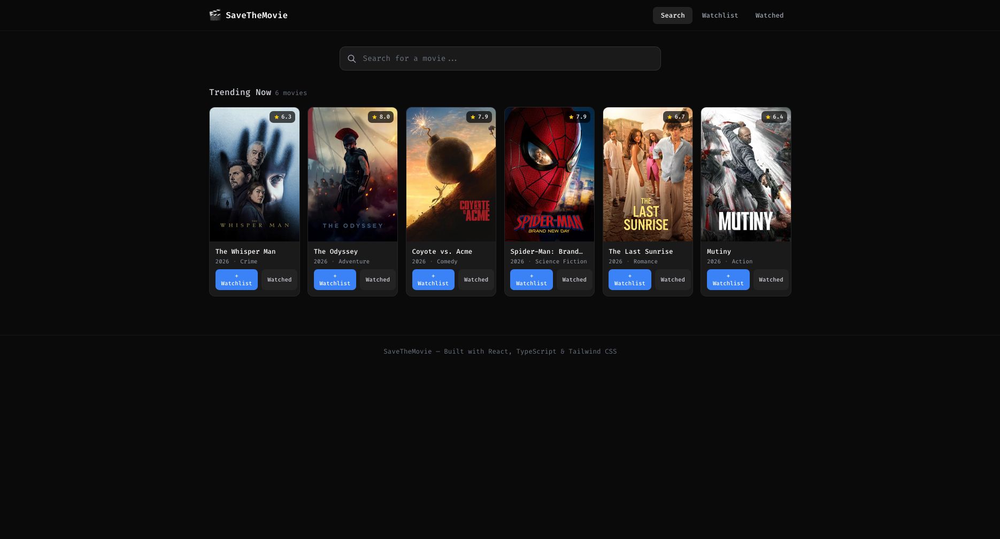

# 🗃️ Stash

A self-hosted multi-media bookmark application for movies, anime, and books — designed for homelabs with TypeScript, Tailwind CSS, and real-time search. Perfect for privacy-focused users who want their data to stay local, with optional server-side API key management via a unified settings console.



## 🏠 Homelab Ready

Stash is built as a **self-hosted solution** for tracking your entire media collection across three categories: movies/TV, anime, and books. Deploy on your homelab with Docker, run locally, or host anywhere — your data stays with you via PostgreSQL.

**Ideal for:**
- 🏡 Homelab enthusiasts
- 🎬📽️📚 Media collectors & curators
- 🔒 Privacy-focused users (keys live server-side)
- 🚀 Self-hosting advocates

## Features

### **Unified Media Search**
- **Search** — Cross-source search across movies, anime, and books (TMDb / Jikan / Google Books APIs)
- **Trending** — Browse trending content per category (Movies & TV, Anime, Books)
- **Persistent Storage** — Bookmarks (Watchlist/Watched) stored in PostgreSQL

### **Multi-Category Organization**
- 📽️ **Movies & TV** (TMDb API) — Genres, ratings, TV shows
- 📺 **Anime** (Jikan API, no key required) — MAL-powered search and metadata
- 📖 **Books** (Google Books API) — Authors, ISBN, cover art

### **Smart Bookmarking**
- **Watchlist** / **Watched** lists per media type
- **Status toggling** (add to watchlist → mark as watched)
- **Category-scoped views** — switch tabs to see per-type libraries

### **Developer-Friendly**
- **Settings console** — Enter API keys for movies & books (Jikan is keyless)
- **Docker-first** — Minimal `docker-compose.yml` (Postgres + one app image)
- **API-first** — All upstream API calls happen server-side; keys never hit the browser
- **Type-safe** — Full TypeScript throughout

## Tech Stack

- React 18 + TypeScript
- Vite
- Express (Node.js) backend
- PostgreSQL for persistence
- Tailwind CSS
- TMDb, Jikan (MyAnimeList), Google Books APIs
- Docker (one app image + one Postgres container)

## Quick Start

### **Docker Compose (Recommended)**

```bash
# Build and run everything
docker compose up --build

# Access at http://localhost:8080
```

Postgres boots with a `stash` database and the app connects automatically. No `.env` needed for a first run.

### **From Source**

```bash
# Install dependencies
npm install

# 1) Start Postgres (or point DATABASE_URL at an existing instance)
docker compose up -d db

# 2) Start dev (Vite on :5173 + Express on :3000)
npm run dev

# Open http://localhost:5173
```

## API Keys

Like the original SaveTheMovie, search ships with a **sample-data fallback** so the app works before any keys are added. To unlock real data:

1. Open **⚙ Settings** (top nav).
2. Paste your key(s):
   - **TMDb API key** — for movies/TV. Get one free at [themoviedb.org/settings/api](https://www.themoviedb.org/settings/api).
   - **Google Books API key** (optional) — helps avoid quota limits.
   - **Jikan API key** (optional) — reserved; Jikan is currently keyless.
3. Keys are saved to PostgreSQL **server-side only** and persist across restarts. No rebuild required.

## Search Categories

Stash is organized into three top-level category tabs, plus view tabs (Search / Watchlist / Watched):
- **Movies & TV** (🎬) — TMDb-powered
- **Anime** (📺) — Jikan-powered (no key needed)
- **Books** (📖) — Google Books-powered

Each category has:
- A category-aware search bar
- Trending content preview
- Your personal Watchlist / Watched lists scoped to that category
- A Settings console (⚙) for API keys

## Architecture

**Frontend (React + Vite)**
- Category-aware bookmark UI (per-type tabs)
- Shared API client (`/api/*`) talking to Express
- No API keys, no direct upstream calls — everything through the server

**Backend (Express + Postgres)**
- Single Express process serves the SPA (`dist/`) and a REST API (`/api/*`)
- PostgreSQL stores bookmarks + settings
- Server-side calls to TMDb / Jikan / Google Books (keys never leave the server)

## API Layer

| Endpoint | Description |
|---|---|
| `GET /api/search?q=&type=movie\|anime\|book` | Search the appropriate provider |
| `GET /api/trending?type=` | Trending per category |
| `GET /api/bookmarks?type=` | User's bookmarks (optionally by status) |
| `POST /api/bookmarks` | Add/update a bookmark |
| `PATCH /api/bookmarks/status` | Toggle watchlist ↔ watched |
| `DELETE /api/bookmarks?type=&providerId=` | Remove a bookmark |
| `GET /api/settings` / `PUT /api/settings` | Read (masked) / update API keys |

## Verification

1. **Dev:** `docker compose up -d db`, then `npm run dev` → open http://localhost:5173. Search each category, bookmark, reload — data persists.
2. **Settings:** open ⚙, save a TMDb key, confirm it's masked & persisted; movie search now hits real TMDb.
3. **Prod:** `docker compose up --build` → http://localhost:8080, repeat the search → bookmark → reload flow.
4. **Database:** `docker compose exec db psql -U postgres -d stash -c "SELECT * FROM bookmarks"`.

## Migration from SaveTheMovie

`Stash` is a **direct evolution** of `SaveTheMovie`:

- **Movies & TV** behavior preserved (search, trending, watchlist/watched, dark theme)
- **Two new categories** (Anime, Books) added with the same UX
- **Settings console** replaces `.env.local` API-key management; keys now live in Postgres
- **localStorage** removed — all data now persists in PostgreSQL
- **Nginx removed** — Express serves the built SPA directly (fewer containers)

## Repository

**GitHub:** https://github.com/BxtGeek/SaveTheMovie

---

## ⭐ Support

If you like Stash, please **star the repository** to show your support!

Have suggestions or ideas for improvement? Feel free to:
- 🐛 [Open an issue](https://github.com/BxtGeek/SaveTheMovie/issues)
- 💡 Share your feedback
- 🤝 Contribute via pull requests

Your feedback helps make Stash better for the homelab community!

## 📄 License

MIT License - feel free to use, modify, and distribute this project for personal or commercial use.

See [LICENSE](LICENSE) for details.